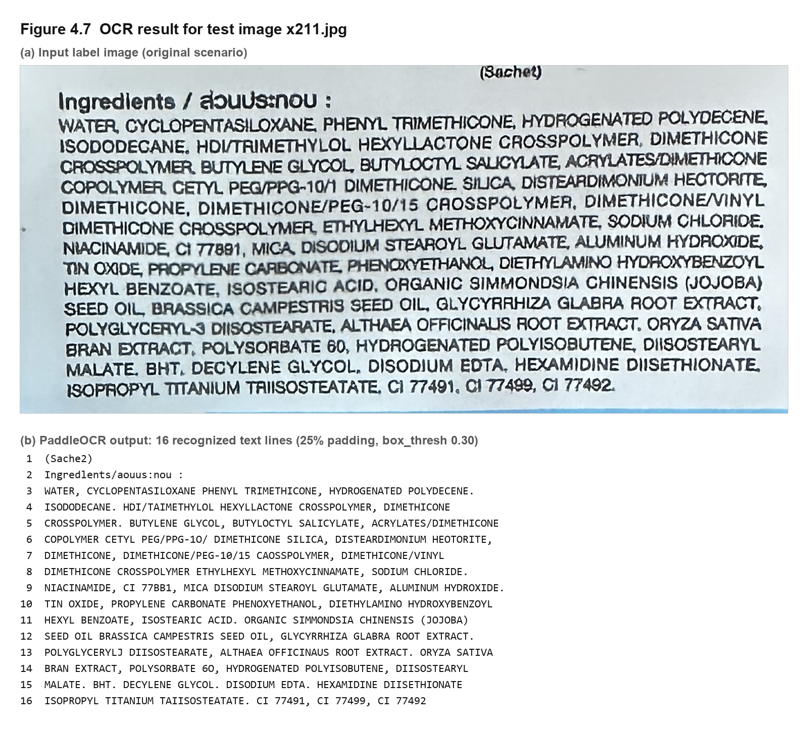
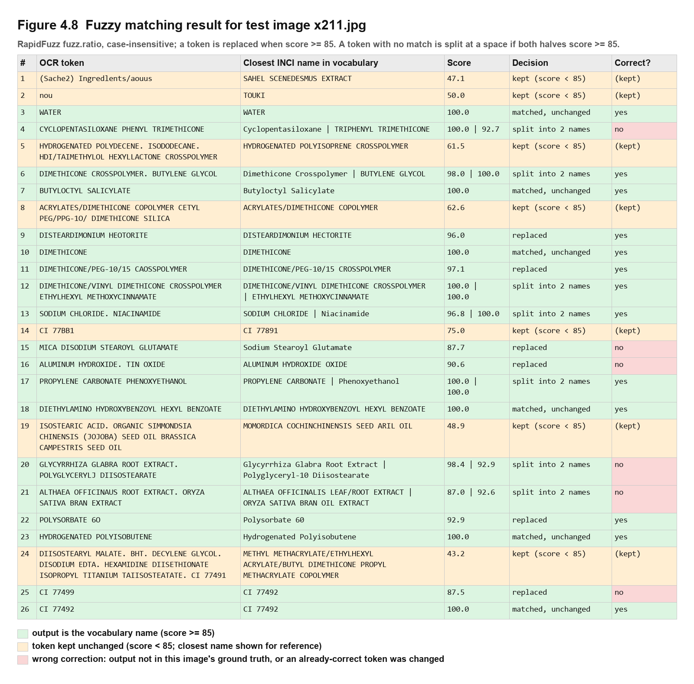

# บทที่ 4 ผลการทดลองและการวิเคราะห์

> ไฟล์นี้เป็นต้นฉบับหลักของบทที่ 4 การแก้ไขเนื้อหาและการบันทึกผลการทดลองเพิ่มเติมของบทนี้ให้ทำในไฟล์นี้ และบันทึกการเปลี่ยนแปลงไว้ในหัวข้อ "บันทึกการแก้ไข" ท้ายไฟล์
> ตัวเลขทุกตัวในบทนี้มาจากไฟล์ผลที่ระบุไว้ใต้ตาราง ซึ่งสร้างซ้ำได้ด้วยสคริปต์ในหัวข้อ 3.13 ข้อความในวงเล็บเหลี่ยม `[...]` คือส่วนที่รอผลหรือรอผู้วิจัยเติม

---

## 4.1 การอ่านผลการทดลอง

- **ชุดข้อมูล:** ผลในหัวข้อ 4.3–4.8 มาจากชุด **Dev** (40 ผลิตภัณฑ์) ซึ่งใช้เลือกค่าพารามิเตอร์ ส่วนผลในหัวข้อ 4.9–4.13 เป็นผลบนชุด **Held-out** (176 ผลิตภัณฑ์ต่อสภาพแวดล้อม) ซึ่งไม่ได้ใช้เลือกค่าใดเลย ผลบน Held-out จึงเป็นค่าประมาณประสิทธิภาพของระบบกับภาพที่ไม่เคยเห็น
- **ตัวชี้วัด:** Set F1 เป็นตัวชี้วัดหลัก CER เป็นตัวชี้วัดเสริม (นิยามในหัวข้อ 3.9) ค่า Set F1 ยิ่งสูงยิ่งดี ค่า CER, WER และ IER ยิ่งต่ำยิ่งดี
- **การตั้งค่าของระบบที่รายงาน** (ยกเว้นระบุไว้เป็นอย่างอื่น): border padding 25%, box_thresh 0.30, เปิด doc unwarping, fuzzy matching ฉบับแก้ไข threshold 85 และคำศัพท์เสริมจาก Dev (`vocabulary_patch_dev.csv`, หัวข้อ 3.6.2) ซึ่งเป็นการตั้งค่าเดียวกับระบบที่ส่งมอบทุกประการ
- **สัญลักษณ์:** ค่าในวงเล็บเหลี่ยมคือช่วงความเชื่อมั่น 95% (bootstrap 10,000 รอบ) เครื่องหมาย \* หมายถึงผลต่างจากค่าอ้างอิงมีนัยสำคัญ (ช่วงความเชื่อมั่น 95% ของผลต่างแบบ paired ไม่ครอบคลุม 0)

## 4.2 ผลการทดลองช่วงต้น (การสำรวจเบื้องต้น)

ก่อนกำหนดขั้นตอนการทดลองในบทที่ 3 ได้ทดลองเทคนิคปรับปรุงคุณภาพภาพแบบดั้งเดิม 11 เทคนิค และโมเดล OCR ทางเลือก ผลในหัวข้อนี้**ใช้เปรียบเทียบกับตัวเลขในหัวข้ออื่นไม่ได้** เพราะใช้ชุดข้อมูลรุ่นก่อน (137 ภาพต้นฉบับ รวม 685 ภาพใน 5 สภาพแวดล้อม) ซึ่งเป็น**ภาพคนละชุดกับชุดข้อมูลปัจจุบัน** เมื่อเทียบข้อความเฉลยที่บันทึกไว้ในผลการทดลองรุ่นก่อนกับชุดปัจจุบัน พบชื่อไฟล์ซ้ำกัน 105 ภาพ แต่ข้อความเฉลยไม่ตรงกันเลยแม้แต่ภาพเดียว (104 ภาพเป็นคนละผลิตภัณฑ์อย่างชัดเจน) และอีก 31 ภาพของชุดรุ่นก่อนไม่มีอยู่ในชุดปัจจุบัน แสดงว่าเมื่อขยายชุดข้อมูลเป็น 216 ภาพ ไฟล์ภาพถูกแทนที่โดยใช้ชื่อไฟล์เดิม (`compare_dataset_versions.py`, `results/dataset_versions.txt`) ใช้การตั้งค่า OCR รุ่นก่อน (ปิด doc unwarping, box_thresh 0.45, ไม่มี padding) และวัดด้วย CER เพียงตัวเดียว จึงรายงานไว้เพื่อแสดงที่มาของการตัดสินใจไม่ใช้ preprocessing แบบดั้งเดิมเท่านั้น

**ตารางที่ 4.1** ค่า CER เฉลี่ยของเทคนิคปรับปรุงคุณภาพภาพ (รุ่นก่อน, 685 ภาพ)

| เทคนิค | mean CER | เทียบกับ baseline |
|---|---|---|
| Deskew + Fuzzy matching | 0.608 | ดีขึ้นเล็กน้อย |
| Deskew | 0.609 | ดีขึ้นเล็กน้อย |
| Fuzzy matching (ฉบับก่อนแก้ไข) | 0.618 | ใกล้เคียง |
| **Baseline (ไม่ปรับภาพ)** | **0.619** | — |
| Tiled OCR | 0.619 | ใกล้เคียง |
| Grayscale | 0.622 | แย่ลงเล็กน้อย |
| Denoise (Non-Local Means) | 0.645 | แย่ลง |
| Contrast adaptive (CLAHE / Histogram Eq.) | 0.648 | แย่ลง |
| Sharpen (unsharp mask) | 0.648 | แย่ลง |
| Upscale bicubic → 480 px | 0.676 | แย่ลง |
| Multi-tier fallback (รวม EDSR super-resolution) | 0.691 | แย่ลง |
| Upscale bicubic → 800 px | 0.707 | แย่ลง |
| Otsu thresholding | 0.903 | แย่ลงมาก |

ที่มา: `EXPERIMENT_SUMMARY.md`, `results/preprocess_*.csv` (ไม่มีการคำนวณช่วงความเชื่อมั่นในรุ่นนั้น)

**ภาพประกอบ:** ไม่มีภาพตัวอย่างเปรียบเทียบภาพต้นฉบับกับภาพหลังปรับปรุง (เช่น Grayscale, Upscale, Otsu Thresholding) เพราะการทดลองรุ่นนั้นไม่ได้เก็บภาพหลังปรับปรุงไว้ และภาพต้นฉบับของชุดข้อมูลรุ่นนั้นไม่มีอยู่แล้ว การสร้างภาพจากชุดข้อมูลปัจจุบันจะไม่ตรงกับข้อความ OCR และค่า CER ที่บันทึกไว้ จึงรายงานเป็นตารางเท่านั้น (ได้ทดลองตรวจสอบแล้ว: การรัน OCR ด้วยการตั้งค่ารุ่นก่อนบนภาพปัจจุบันชื่อเดียวกันได้ข้อความที่ต่างจากที่บันทึกไว้เกือบทั้งหมด)

เทคนิคส่วนใหญ่ไม่ช่วยหรือทำให้ผลแย่ลง โดยเฉพาะการทำภาพขาวดำ (thresholding) และการขยายภาพ ซึ่งสอดคล้องกับการที่โมเดล PP-OCRv6 ฝึกมากับภาพสีจริง และย่อขยายภาพตามขั้นตอนภายในของโมเดลอยู่แล้ว มีเพียง deskew ที่ดีขึ้นเล็กน้อย จึงตัดสินใจหันไปปรับการตั้งค่าของโมเดลและขั้นตอนหลัง OCR แทน

**โมเดล OCR ทางเลือก:** GOT-OCR2.0 ได้ CER เฉลี่ย 0.639 (แย่กว่า baseline 0.619) และประมาณร้อยละ 32 ของภาพมี CER สูงกว่า 0.90 เพราะโมเดลสร้างข้อความที่ไม่เกี่ยวกับภาพขึ้นมาเอง (hallucination) โดยเฉพาะในภาพเบลอและภาพกลางคืน ส่วน Qwen2.5-VL-3B (4-bit) ทดลองเชิงคุณภาพเท่านั้น พบว่าสร้างชื่อสารเคมีที่ไม่มีอยู่จริง จึงเลือกใช้ PaddleOCR ต่อ

## 4.3 การตั้งค่าโมดูลในตัวของ PaddleOCR

**ตารางที่ 4.2** ผลของการเปิด/ปิด document unwarping และ textline orientation (Dev, n = 40)

| doc unwarping | textline orientation | Set Precision | Set Recall | **Set F1** | CER |
|---|---|---|---|---|---|
| ปิด | ปิด | 0.461 | 0.487 | 0.467 | 0.395 |
| **เปิด** | ปิด | 0.565 | 0.632 | **0.592** | 0.262 |
| ปิด | เปิด | 0.453 | 0.476 | 0.458 | 0.408 |
| **เปิด** | **เปิด** (ค่าที่ใช้) | 0.565 | 0.632 | **0.592** | 0.262 |

ที่มา: `results/experiment_docfeatures_ablation_summary.csv` (`old/experiment_docfeatures_ablation.py`)

Document unwarping เพิ่ม Set F1 จาก 0.467 เป็น 0.592 ส่วน textline orientation **ไม่มีผลเลย** (ได้ค่าเท่ากันทุกตัวเมื่อเปิด unwarping) หมายเหตุ: การทดลองนี้ทำด้วยขั้นตอน fuzzy matching ฉบับก่อนแก้ไข (threshold 90) ซึ่งไม่ได้บันทึกข้อความ OCR ดิบไว้ จึงคำนวณใหม่ตามขั้นตอนปัจจุบันไม่ได้ แต่ผลต่างเกิดที่ขั้นตอน OCR ซึ่งไม่เกี่ยวกับ fuzzy matching และมีขนาดใหญ่มาก ข้อสรุปจึงไม่น่าจะเปลี่ยน

**ภาพประกอบ:** ไม่มีภาพตัวอย่างเปรียบเทียบข้อความ OCR เมื่อเปิดและปิด document unwarping เพราะการทดลองนี้บันทึกเฉพาะตัวชี้วัดรายภาพ ไม่ได้บันทึกข้อความ OCR ไว้ จึงรายงานเป็นตารางที่ 4.2 เท่านั้น

## 4.4 การเลือกค่า box_thresh

**ตารางที่ 4.3** ผลของการตั้งค่าโมดูลตรวจจับข้อความ (Dev, n = 40, fuzzy threshold 85, คำศัพท์เสริมแบบ cross-fitting)

| การตั้งค่า | Set Precision | Set Recall | **Set F1** | CER | ผลต่าง F1 เทียบกับ box_thresh 0.30 |
|---|---|---|---|---|---|
| box_thresh 0.45 (ค่าเริ่มต้นของโมเดล) | 0.705 | 0.622 | 0.642 | 0.332 | −0.038 [−0.073, −0.011] \* |
| **box_thresh 0.30 (ค่าที่เลือก)** | 0.706 | 0.671 | **0.680** | **0.256** | — |
| box_thresh 0.25 | 0.706 | 0.671 | 0.680 | 0.256 | 0.000 |
| box_thresh 0.20 | 0.706 | 0.671 | 0.680 | 0.256 | 0.000 |
| box_thresh 0.15 | 0.706 | 0.671 | 0.680 | 0.256 | 0.000 |
| unclip_ratio 1.8 | 0.642 | 0.559 | 0.576 | 0.380 | −0.104 [−0.164, −0.051] \* |
| box_thresh 0.30 + unclip_ratio 1.8 | 0.637 | 0.585 | 0.597 | 0.323 | −0.083 [−0.138, −0.034] \* |
| limit_side_len 1536 | 0.571 | 0.486 | 0.508 | 0.471 | −0.173 [−0.263, −0.086] \* |

ที่มา: `results/chapter4/dev_detection_settings.csv` (`chapter4_analyses.py`)

การลด box_thresh จาก 0.45 เป็น 0.30 เพิ่ม Set Recall จาก 0.622 เป็น 0.671 โดย Precision แทบไม่เปลี่ยน ซึ่งสอดคล้องกับสมมติฐานว่าโมดูลตรวจจับข้อความพบกรอบข้อความจริงอยู่แล้ว แต่ทิ้งไปเพราะคะแนนไม่ถึงเกณฑ์ ค่า 0.25, 0.20 และ 0.15 ให้ข้อความ OCR เหมือนกับ 0.30 ทุกตัวอักษร แสดงว่ากรอบที่กู้คืนได้ด้วยการลดเกณฑ์ถูกกู้คืนครบแล้วที่ 0.30 ส่วนการขยายกรอบ (unclip_ratio) และการเพิ่มขนาดภาพเข้าโมดูล (limit_side_len) ทำให้ผลแย่ลงอย่างมีนัยสำคัญ

## 4.5 การทดสอบความไวของ Border Padding

**ตารางที่ 4.4** ผลของขนาดขอบภาพ (Dev, n = 40)

| ขนาดขอบ | Set Precision | Set Recall | **Set F1** | CER | ผลต่าง F1 เทียบกับ 25% |
|---|---|---|---|---|---|
| 0% (ไม่เพิ่มขอบ) | 0.715 | 0.616 | 0.652 | 0.261 | −0.028 [−0.084, +0.036] |
| 10% | 0.679 | 0.636 | 0.646 | 0.292 | −0.034 [−0.086, +0.012] |
| 15% | 0.688 | 0.653 | 0.663 | 0.288 | −0.017 [−0.081, +0.038] |
| **25% (ค่าที่ใช้)** | 0.706 | 0.671 | **0.680** | 0.256 | — |
| 35% | 0.718 | 0.693 | 0.698 | 0.254 | +0.017 [−0.015, +0.052] |
| 50% | 0.726 | 0.694 | 0.700 | 0.272 | +0.020 [−0.011, +0.053] |

ที่มา: `results/chapter4/dev_padding.csv` (`chapter4_analyses.py`)

**ตารางที่ 4.4ข** ผลของขนาดขอบภาพต่อ OCR อย่างเดียว (ไม่ผ่าน fuzzy matching, Dev, n = 40)

| ขนาดขอบ | Set F1 (OCR อย่างเดียว) | ผลต่าง F1 เทียบกับ 25% | CER (OCR อย่างเดียว) | ผลต่าง CER เทียบกับ 25% |
|---|---|---|---|---|
| 0% | 0.567 | −0.076 [−0.136, −0.009] \* | 0.272 | +0.005 [−0.042, +0.052] |
| 10% | 0.610 | −0.033 [−0.086, +0.011] | 0.301 | +0.034 [+0.008, +0.063] \* |
| 15% | 0.626 | −0.018 [−0.078, +0.035] | 0.294 | +0.027 [−0.005, +0.066] |
| **25%** | **0.644** | — | 0.267 | — |
| 35% | 0.663 | +0.020 [−0.008, +0.051] | **0.261** | −0.006 [−0.033, +0.021] |
| 50% | 0.656 | +0.012 [−0.017, +0.040] | 0.274 | +0.007 [−0.025, +0.043] |

ที่มา: คำนวณจาก `results/sweep_cache/pad_*.json` (ข้อความ OCR ดิบ) — เพิ่มเมื่อ 2026-10-19

เมื่อวัดที่ผล OCR โดยตรง การเพิ่มขอบ 25% ดีกว่าการไม่เพิ่มขอบอย่างมีนัยสำคัญ (Set F1 +0.076) แสดงว่าการเพิ่มขอบภาพช่วยให้ OCR อ่านข้อความได้มากขึ้นจริง แต่เมื่อผ่าน fuzzy matching แล้ว ผลต่างนี้ลดลงจนไม่มีนัยสำคัญ (ตารางที่ 4.4) ขนาด 35% เป็นค่าเดียวที่ดีกว่า 25% ทั้ง Set F1 และ CER ทั้งก่อนและหลัง fuzzy matching แต่ไม่มีนัยสำคัญ ส่วน 50% ได้ Set F1 สูงกว่าแต่ CER แย่กว่า 25%

ในภาพรวม ไม่มีขนาดขอบใดที่ต่างจาก 25% อย่างมีนัยสำคัญหลังผ่าน fuzzy matching ช่วงความเชื่อมั่นของผลต่างกว้างมาก (ประมาณ ±0.05) เมื่อเทียบกับขนาดของผลต่าง ขนาด 35% และ 50% มีค่าเฉลี่ย Set F1 สูงกว่า 25% แต่ CER ที่ 50% แย่กว่า ข้อมูลนี้**ไม่เพียงพอจะสรุปว่าขนาดขอบใดดีที่สุด** ระบบจึงคงค่า 25% ซึ่งกำหนดไว้ตั้งแต่ก่อนการทดสอบนี้ เหตุผลคือ (1) 25% ดีกว่าการไม่เพิ่มขอบอย่างมีนัยสำคัญที่ระดับ OCR (ตารางที่ 4.4ข) (2) ไม่มีขนาดอื่นที่ดีกว่า 25% อย่างมีนัยสำคัญ ขนาด 50% ที่ได้ค่าเฉลี่ย Set F1 สูงสุดหลังผ่าน fuzzy matching มี CER แย่กว่า 25% ทั้งก่อนและหลัง fuzzy matching และ (3) การเปลี่ยนค่าตามความต่างที่ไม่มีนัยสำคัญบนภาพ 40 ภาพ เสี่ยงต่อการปรับค่าให้เข้ากับชุด Dev มากเกินไป ไม่ได้ทดสอบขนาดขอบอื่นบนชุด Held-out เพื่อคงหลักการที่ไม่ใช้ Held-out ในการเลือกค่า

## 4.6 การทดสอบการขยายภาพร่วมกับการตั้งค่าใหม่

เนื่องจากการขยายภาพในหัวข้อ 4.2 ทดลองกับการตั้งค่า OCR รุ่นก่อน จึงทดสอบซ้ำร่วมกับการตั้งค่าใหม่ (padding 25%, doc unwarping, box_thresh 0.30) โดยขยายภาพที่สูงน้อยกว่า 480 พิกเซลให้สูง 480 พิกเซลด้วย cubic interpolation

**ตารางที่ 4.5** ผลของการขยายภาพ (Dev, n = 40, ทุกภาพถูกขยาย)

| การตั้งค่า | Set Precision | Set Recall | **Set F1** | CER |
|---|---|---|---|---|
| ไม่ขยายภาพ | 0.565 | 0.632 | **0.592** | **0.262** |
| ขยายภาพเป็น 480 px | 0.533 | 0.566 | 0.533 | 0.342 |

ที่มา: `results/experiment_upscale_current_pipeline.csv` (`experiment_upscale_current_pipeline.py`) — ทดลองด้วย fuzzy matching ฉบับก่อนแก้ไข (threshold 90) และไม่ได้บันทึกข้อความ OCR ดิบไว้

การขยายภาพยังคงทำให้ผลแย่ลงทั้ง Precision และ Recall แม้ใช้ร่วมกับการตั้งค่าใหม่

## 4.7 การเลือก Fuzzy Threshold

**ตารางที่ 4.6** ผลของ fuzzy threshold บนชุด Dev ที่ใช้เลือกค่า (n = 40, คำศัพท์เสริมแบบ cross-fitting)

| Threshold | Set Precision | Set Recall | **Set F1** [95% CI] | CER | ผลต่าง F1 เทียบกับ 90 |
|---|---|---|---|---|---|
| ไม่ใช้ fuzzy | 0.670 | 0.634 | 0.644 [0.546, 0.732] | 0.267 | −0.033 \* |
| 75 | 0.690 | 0.642 | 0.657 | 0.279 | −0.020 |
| 80 | 0.703 | 0.662 | 0.673 | 0.268 | −0.004 |
| 82 | 0.704 | 0.666 | 0.676 | 0.261 | −0.001 |
| 84 | 0.706 | 0.671 | 0.680 | 0.257 | +0.003 |
| **85 (ค่าที่เลือก)** | 0.706 | 0.671 | **0.680** [0.583, 0.768] | 0.256 | +0.003 |
| 86 | 0.704 | 0.669 | 0.678 | 0.256 | +0.002 |
| 88 | 0.703 | 0.668 | 0.678 | 0.254 | +0.001 |
| 90 | 0.703 | 0.668 | 0.677 | **0.253** | — |
| 92 | 0.700 | 0.666 | 0.675 | 0.254 | −0.002 |
| 95 | 0.693 | 0.659 | 0.667 | 0.256 | −0.010 \* |

ที่มา: `results/sweep_fuzzy_threshold_dev_min1_summary.csv` (`sweep_fuzzy_threshold.py --patch dev_min1`, แถว variant = current, split = dev)

ค่า 85 ได้ Set F1 เฉลี่ยสูงสุดบน Dev จึงถูกเลือก แต่ค่า 82–92 ต่างกันไม่เกิน 0.006 และไม่ต่างจากค่าอ้างอิงอย่างมีนัยสำคัญ ค่าที่ต่ำเกินไป (75) และสูงเกินไป (95) ทำให้ผลแย่ลง เพราะ threshold ต่ำทำให้คำที่ถูกอยู่แล้วถูก "แก้" เป็นชื่ออื่นที่คล้ายกัน ส่วน threshold สูงทำให้คำที่อ่านผิดเล็กน้อยไม่ได้รับการแก้ไข

**การเลือกค่าโดยไม่ใช้ cross-fitting:** หากให้คะแนนภาพใน Dev ด้วยคำศัพท์เสริมที่สร้างจากเฉลยของภาพเหล่านั้นเอง ค่าที่ได้ Set F1 สูงสุดจะเป็น 75 (Dev F1 = 0.711) เพราะคำศัพท์มีคำตอบของภาพนั้นอยู่แล้ว threshold ที่ต่ำจึงดึงทุกคำให้ตรงกับเฉลย แต่ค่า 75 ให้ผลบน Held-out เพียง 0.632 ต่ำกว่าค่า 85 อย่างมีนัยสำคัญ ผลนี้ยืนยันความจำเป็นของ cross-fitting ในหัวข้อ 3.8.2

**ผลบน Held-out ของแต่ละ threshold (ใช้รายงานเท่านั้น ไม่ได้ใช้เลือกค่า):** ค่า 85 ที่เลือกจาก Dev ได้ Set F1 บน Held-out 0.650 ซึ่งเป็นค่าสูงสุดในบรรดา threshold ที่ทดลอง และสูงกว่า 90 อย่างมีนัยสำคัญ (+0.005 [+0.001, +0.009]) แสดงว่าค่าที่เลือกจาก Dev ใช้ได้ดีกับภาพที่ไม่เคยเห็น (ที่มา: ไฟล์เดียวกัน, split = heldout)

## 4.8 เงื่อนไขอัตราส่วนความยาว

**ตารางที่ 4.7** ผลของเงื่อนไขอัตราส่วนความยาวระหว่าง token กับชื่อที่จับคู่ได้ (Dev, n = 40, threshold 85)

| อัตราส่วนสูงสุด | Set F1 | CER |
|---|---|---|
| 1.2 | 0.678 | 0.256 |
| 1.4, 1.6 (ค่าที่ใช้), 1.8, 2.0, 2.5 และไม่ใช้เงื่อนไข | 0.680 | 0.256 |

ที่มา: `results/chapter4/dev_length_ratio.csv` (`chapter4_analyses.py`)

ทุกค่าตั้งแต่ 1.4 ขึ้นไปให้ผลเหมือนกันทุกภาพ ตรงกับการวิเคราะห์ในหัวข้อ 3.7 ที่ว่าที่ threshold 85 คู่คำที่ผ่านเกณฑ์จะมีอัตราส่วนความยาวไม่เกิน 1.35 อยู่แล้ว เงื่อนไข 1.6 จึงไม่มีผลต่อระบบที่ใช้ threshold 85

## 4.9 คำศัพท์เสริม (Vocabulary Patch)

วิธีการสร้างคำศัพท์เสริมและเหตุผลของแต่ละขั้นตอนอยู่ในหัวข้อ 3.6 หัวข้อนี้รายงานผลการทดลองทั้งหมดที่เกี่ยวข้อง ทุกการทดลองใช้ข้อความ OCR ที่บันทึกไว้ (box_thresh 0.30, padding 25%) และ fuzzy matching ฉบับแก้ไขที่ threshold 85 ยกเว้นหัวข้อ 4.9.5 ที่ระบุไว้ ผลทั้งหมดสร้างด้วย `analyze_vocab_patch.py` ไฟล์ผลอยู่ใน `results/vocab_patch/`

### 4.9.1 ความครอบคลุมของคำศัพท์

**ตารางที่ 4.8** ร้อยละของชื่อสารในข้อความเฉลยที่มีอยู่ในคำศัพท์ทุกตัวอักษร (ไม่สนตัวพิมพ์เล็ก/ใหญ่)

| ชุดข้อความเฉลย | คำศัพท์ | นับซ้ำ | ไม่ซ้ำ |
|---|---|---|---|
| Held-out (6,677 / 1,439 ชื่อ) | ฐานข้อมูลหลักอย่างเดียว | 41.6% | 32.1% |
| | + ชุดที่ระบบใช้ (399 ชื่อจาก Dev) | **83.3%** | **52.6%** |
| | + ชุดเดิม (199 ชื่อจากเฉลยทั้งหมด) | 82.9% | 45.9% |
| ทั้งหมด (8,198 / 1,574 ชื่อ) | ฐานข้อมูลหลักอย่างเดียว | 41.4% | 31.3% |
| | + ชุดที่ระบบใช้ | 86.4% | 56.7% |
| | + ชุดเดิม | 83.0% | 44.0% |

ที่มา: `results/vocab_patch/coverage.csv`

คำศัพท์จาก Dev เพียง 40 ผลิตภัณฑ์ครอบคลุมชื่อสารที่ปรากฏบนฉลากของ Held-out ได้ 83.3% (นับซ้ำ) มากกว่าชุดเดิมเล็กน้อย แม้ชุดเดิมสร้างจากเฉลยของ Held-out เองด้วย เพราะชื่อที่พบบ่อยส่วนใหญ่ปรากฏใน 40 ผลิตภัณฑ์แรกแล้ว และชุดจาก Dev รวมชื่อที่พบเพียงผลิตภัณฑ์เดียวด้วย (k ≥ 1) ชื่อที่ไม่ซ้ำยังขาดอยู่ประมาณครึ่งหนึ่ง แต่ส่วนใหญ่เป็นชื่อหายากที่ปรากฏในผลิตภัณฑ์เดียว

### 4.9.2 การเลือกเกณฑ์ k บนชุด Dev

**ตารางที่ 4.9** ผลของเกณฑ์ k บนชุด Dev (n = 40) ภาพแต่ละภาพให้คะแนนด้วยคำศัพท์ที่สร้างจากเฉลยของอีก 4 fold (32 ผลิตภัณฑ์) เท่านั้น

| คำศัพท์เสริม | Set Precision | Set Recall | **Set F1** [95% CI] | CER | ผลต่าง F1 เทียบกับ k ≥ 1 |
|---|---|---|---|---|---|
| ไม่ใช้คำศัพท์เสริม | 0.690 | 0.649 | 0.661 [0.568, 0.750] | 0.275 | −0.019 [−0.029, −0.010] \* |
| **k ≥ 1 (ค่าที่เลือก)** | **0.706** | **0.671** | **0.680** [0.586, 0.768] | **0.256** | — |
| k ≥ 2 | 0.703 | 0.667 | 0.677 | 0.263 | −0.004 [−0.007, −0.001] \* |
| k ≥ 3 | 0.699 | 0.662 | 0.672 | 0.264 | −0.008 [−0.014, −0.003] \* |
| k ≥ 4 | 0.699 | 0.662 | 0.672 | 0.265 | −0.008 [−0.015, −0.003] \* |
| k ≥ 5 | 0.699 | 0.662 | 0.672 | 0.266 | −0.008 [−0.015, −0.003] \* |

ที่มา: `results/vocab_patch/dev_cutoff_crossfit.csv`

k ≥ 1 ได้ Set F1 สูงสุดและ CER ต่ำสุด และดีกว่าทุกค่าอย่างมีนัยสำคัญ ทั้ง Precision และ Recall สูงขึ้นเมื่อใช้คำศัพท์มากขึ้น แสดงว่าชื่อที่เพิ่มเข้ามาช่วยแก้คำที่อ่านผิดได้มากกว่าทำให้แก้ผิด ผลนี้ใช้เฉพาะชุด Dev จึงเป็นหลักฐานในการเลือกค่า k = 1 ที่ถูกต้องตามหลักการ และให้ค่าเดียวกับการปรับสัดส่วนจากชุดเดิม (หัวข้อ 3.6.5)

### 4.9.3 ผลของคำศัพท์เสริมบนชุด Held-out (รายงานเท่านั้น)

**ตารางที่ 4.10** Set F1 บน Held-out (n = 176) เมื่อใช้คำศัพท์เสริมต่างชุด ผลต่างเทียบกับชุดที่ระบบใช้ ในวงเล็บคือ 95% CI ของผลต่าง

| สภาพแวดล้อม | ไม่ใช้คำศัพท์เสริม | **ชุดที่ระบบใช้ (Dev k ≥ 1, 399 ชื่อ)** | Dev k ≥ 2 (131 ชื่อ) | Dev k ≥ 3 (64 ชื่อ) | ชุดเดิม (199 ชื่อ, รั่วไหล) |
|---|---|---|---|---|---|
| Original | 0.627 (−0.023 \*) | **0.650** | 0.646 (−0.004 \*) | 0.644 (−0.006 \*) | 0.651 (+0.001 [−0.002, +0.004]) |
| Indoor | 0.584 (−0.022 \*) | **0.606** | 0.601 (−0.005 \*) | 0.597 (−0.008 \*) | 0.606 (+0.001 [−0.002, +0.003]) |
| Low light | 0.500 (−0.023 \*) | **0.522** | 0.516 (−0.006 \*) | 0.513 (−0.009 \*) | 0.523 (+0.001 [−0.001, +0.004]) |
| Blur | 0.145 (−0.009 \*) | **0.154** | 0.152 (−0.002 \*) | 0.151 (−0.003 \*) | 0.155 (+0.001 [−0.000, +0.003]) |
| Night | 0.151 (−0.008 \*) | **0.159** | 0.157 (−0.002 \*) | 0.156 (−0.003 \*) | 0.159 (+0.001 [−0.002, +0.003]) |

\* = ต่างจากชุดที่ระบบใช้อย่างมีนัยสำคัญ ที่มา: `results/vocab_patch/heldout_patches.csv` (มี Precision, Recall, CER และช่วงความเชื่อมั่นครบ)

ผลบน Held-out ไม่ได้ใช้เลือกค่าใด แต่ยืนยันข้อสรุปจาก Dev ทุกข้อ

1. **คำศัพท์เสริมช่วยเพิ่มความแม่นยำจริง** — การไม่ใช้คำศัพท์เสริมทำให้ Set F1 ลดลง 0.022–0.023 ในภาพปกติ และ 0.008–0.009 ในภาพเบลอ/กลางคืน อย่างมีนัยสำคัญทุกสภาพแวดล้อม CER ของ Original ก็ดีขึ้นจาก 0.277 เป็น 0.262
2. **k ≥ 1 ดีที่สุดในบรรดาชุดที่สร้างจาก Dev** — ยิ่งเพิ่ม k คำศัพท์ยิ่งน้อยลง และ Set F1 ยิ่งลดลงในทุกสภาพแวดล้อม
3. **ขนาดของการรั่วไหลในผลรุ่นก่อน** — ชุดเดิมที่สร้างจากเฉลยทั้งหมด (รวมเฉลยของ Held-out) ให้ Set F1 สูงกว่าชุดที่ระบบใช้เพียง 0.001 (ไม่มีนัยสำคัญในทุกสภาพแวดล้อม) การรั่วไหลจึงทำให้ตัวเลขรุ่นก่อนสูงเกินจริงน้อยมาก แต่การใช้ชุดจาก Dev ทำให้ผลที่รายงานปราศจากการรั่วไหลโดยไม่เสียความแม่นยำ

### 4.9.4 การวิเคราะห์ความไวของเกณฑ์ k ในช่วงกว้าง

เพื่อดูแนวโน้มของ k ในช่วงที่กว้างกว่าที่ทำได้บน Dev จึงทดลอง 5-fold cross-validation บนทั้ง 216 ผลิตภัณฑ์ (Original) คำศัพท์ของแต่ละ fold สร้างจากเฉลยของอีก 4 fold (ประมาณ 173 ผลิตภัณฑ์) โดยปรับค่า k ตามสัดส่วนจำนวนผลิตภัณฑ์ การทดลองนี้ใช้เฉลยของ Held-out ด้วย จึง**ไม่ได้ใช้ในการเลือกค่าใด** เป็นข้อมูลประกอบเท่านั้น

**ตารางที่ 4.11** ผลของเกณฑ์ k ด้วย 5-fold cross-validation (n = 216)

| เกณฑ์ (เทียบจาก 216 ผลิตภัณฑ์) | k จริงต่อ fold | ขนาดคำศัพท์เฉลี่ยต่อ fold | Set F1 [95% CI] | CER | ผลต่าง F1 เทียบกับ k ≥ 5 |
|---|---|---|---|---|---|
| ไม่ใช้คำศัพท์เสริม | — | 0 | 0.634 | 0.277 | −0.022 \* |
| k ≥ 1 | 1 | 959 | **0.661** [0.615, 0.705] | **0.257** | +0.005 [+0.002, +0.008] \* |
| k ≥ 2 และ k ≥ 3 | 2 | 433 | 0.659 | 0.258 | +0.003 \* |
| k ≥ 4 | 3 | 290 | 0.657 | 0.260 | +0.001 |
| k ≥ 5 (เกณฑ์ของชุดเดิม) | 4 | 211 | 0.656 [0.611, 0.700] | 0.261 | — |
| k ≥ 7 | 6 | 127 | 0.654 | 0.263 | −0.002 \* |
| k ≥ 10 | 8 | 90 | 0.650 | 0.264 | −0.006 \* |
| k ≥ 15 | 12 | 59 | 0.650 | 0.266 | −0.007 \* |
| k ≥ 20 | 16 | 45 | 0.649 | 0.267 | −0.007 \* |

ที่มา: `results/vocab_patch/cv216_cutoff.csv` (k ≥ 2 กับ k ≥ 3 ให้ค่า k จริงเท่ากันหลังปรับสัดส่วน จึงได้ผลเดียวกัน)

แนวโน้มเหมือนกับผลบน Dev และ Held-out: ยิ่งใช้คำศัพท์มาก (k ต่ำ) ยิ่งดี Set F1 สูงสุดที่ k ≥ 1 ซึ่งใช้ชื่อสารที่ขาดทั้งหมด (959 ชื่อต่อ fold โดยเฉลี่ย) ส่วนการเพิ่ม k ทำให้ผลแย่ลงต่อเนื่อง ความต่างระหว่าง k ≥ 1 กับ k ≥ 5 มีขนาดเล็ก (0.005) เทียบกับความต่างระหว่างการใช้และไม่ใช้คำศัพท์เสริม (0.022–0.027)

### 4.9.5 คำศัพท์เสริมภายใต้ขั้นตอน Fuzzy Matching ฉบับก่อนแก้ไข

**ตารางที่ 4.12** Set F1 บน Held-out Original (n = 176) เมื่อใช้ fuzzy matching ฉบับก่อนแก้ไข (แก้ทีละบรรทัด, แยกตัวพิมพ์เล็ก/ใหญ่, threshold 90)

| คำศัพท์เสริม | Set F1 | CER |
|---|---|---|
| ไม่ใช้คำศัพท์เสริม | 0.5705 | 0.2656 |
| ชุดที่ระบบใช้ (399 ชื่อ) | 0.5704 | 0.2651 |
| ชุดเดิม (199 ชื่อ) | 0.5711 | 0.2649 |

ที่มา: `results/vocab_patch/prefix_code_heldout_original.csv`

ภายใต้ fuzzy matching ฉบับก่อนแก้ไข คำศัพท์เสริม**แทบไม่มีผลเลย** (ต่างกันไม่เกิน 0.001) เพราะการเทียบแบบแยกตัวพิมพ์เล็ก/ใหญ่ทำให้ข้อความ OCR ที่เป็นตัวพิมพ์ใหญ่ เช่น "GLYCERIN" ได้คะแนนต่ำกว่าเกณฑ์เมื่อเทียบกับ "Glycerin" ในคำศัพท์เสริม หลังแก้ไขข้อบกพร่อง คำศัพท์เสริมจึงเพิ่ม Set F1 ได้ประมาณ 0.02 (ตารางที่ 4.10) ข้อความในเอกสารรุ่นก่อนที่ว่าคำศัพท์เสริมช่วยเพิ่มความแม่นยำอย่างวัดผลได้ จึงไม่เป็นจริงสำหรับระบบรุ่นก่อน แต่เป็นจริงสำหรับระบบปัจจุบัน

### 4.9.6 การแก้คำผิดจากชื่อที่คล้ายกัน

การเพิ่มชื่อหายากทำให้เกิดการแก้คำผิดจริงในบางกรณี คือชื่อที่ถูกต้องในฉลากถูกแทนด้วยชื่ออื่นที่คล้ายกันมาก (คะแนน `fuzz.ratio` ประมาณ 90–95) เช่น ชื่อที่ต่างกันเพียงตัวเลขหนึ่งหลัก ตัวอักษรหนึ่งตัว หรือคำต่อท้ายสั้น ๆ เพื่อดูผลสุทธิ จึงเทียบ Set F1 รายภาพระหว่างการใช้และไม่ใช้คำศัพท์เสริม

**ตารางที่ 4.12ข** จำนวนภาพที่คำศัพท์เสริม (ชุดที่ระบบใช้) ทำให้ Set F1 เปลี่ยนไป (Held-out Original, n = 176, threshold 85)

| ผลของคำศัพท์เสริม | จำนวนภาพ |
|---|---|
| Set F1 เพิ่มขึ้น | 56 (31.8%) |
| Set F1 ลดลง | 7 (4.0%) |
| ไม่เปลี่ยน | 113 (64.2%) |

ที่มา: คำนวณจากข้อความ OCR ใน `results/ocr_paddle_fuzzy_FINAL_original_full_validation.csv` เทียบคำศัพท์ฐานข้อมูลหลักอย่างเดียวกับฐานข้อมูลหลัก + ชุดที่ระบบใช้ — เพิ่มเมื่อ 2026-10-19

ภาพที่ดีขึ้นมีมากกว่าภาพที่แย่ลงประมาณ 8 เท่า การแก้คำผิดจากชื่อที่คล้ายกันจึงเกิดขึ้นจริงแต่น้อยกว่าประโยชน์ที่ได้มาก ความกังวลเรื่องชื่อคล้ายกันซึ่งเป็นเหตุผลของการใช้ k ≥ 5 ในชุดเดิมจึงไม่ได้รับการยืนยันในภาพรวม

**ข้อความในเอกสารรุ่นก่อน:** เอกสารรุ่นก่อนระบุว่าการเพิ่มคำศัพท์แบบ "ใส่ทุกชื่อที่หาได้" (2,023 ชื่อ) ทำให้ผลแย่ลง ไม่พบสคริปต์หรือไฟล์ผลของการทดลองนั้นในโครงงาน และผลในหัวข้อ 4.9.2–4.9.4 ให้ข้อสรุปตรงข้าม จึงไม่ใช้ข้อความนั้น

### 4.9.7 สรุปผลเรื่องคำศัพท์เสริม

| ประเด็น | ผล |
|---|---|
| ความครอบคลุมบน Held-out | ฐานข้อมูลหลัก 41.6% → เมื่อเสริมคำศัพท์ 83.3% (นับซ้ำ) |
| ผลต่อ Set F1 บน Held-out Original | 0.627 → 0.650 (+0.023, มีนัยสำคัญ) |
| เกณฑ์ k ที่เลือก | k ≥ 1 เลือกจาก Dev แบบ cross-fitting (ดีกว่า k = 2–5 อย่างมีนัยสำคัญ) และสอดคล้องกับการปรับสัดส่วนจากชุดเดิม |
| ผลของการรั่วไหลในผลรุ่นก่อน | ไม่เกิน 0.001 Set F1 (ไม่มีนัยสำคัญ) |
| ภายใต้ fuzzy matching ฉบับก่อนแก้ไข | คำศัพท์เสริมไม่มีผล (ปัญหาตัวพิมพ์เล็ก/ใหญ่) |
| ข้อจำกัด | คำศัพท์สร้างจากข้อความเฉลยที่ถอดโดย AI จาก 40 ผลิตภัณฑ์ ต้นเหตุคือฐานข้อมูลหลัก (รวบรวมจาก Open Beauty Facts, CosIng, PubChem, Kaggle) ขาดชื่อพื้นฐาน การเติมชื่อที่ขาดจากแหล่งต้นทางโดยตรงเป็นแนวทางพัฒนาต่อ |

## 4.10 ผลกระทบของการแก้ไขข้อบกพร่องในขั้นตอน Fuzzy Matching

**ตารางที่ 4.13** Set F1 บน Held-out (n = 176) ก่อนและหลังแก้ไขข้อบกพร่อง

| สภาพแวดล้อม | OCR อย่างเดียว | Fuzzy ฉบับก่อนแก้ไข (threshold 90, คำศัพท์จากเฉลยทั้งหมด) | **Fuzzy ฉบับแก้ไข (ระบบที่รายงาน)** | ผลต่าง ฉบับแก้ไข − ก่อนแก้ไข |
|---|---|---|---|---|
| Original | 0.613 | 0.567 | **0.650** | +0.083 [+0.066, +0.100] \* |
| Indoor | 0.566 | 0.531 | **0.606** | +0.075 [+0.056, +0.094] \* |
| Low light | 0.487 | 0.468 | **0.522** | +0.055 [+0.036, +0.073] \* |
| Blur | 0.144 | 0.138 | **0.154** | +0.016 [+0.005, +0.029] \* |
| Night | 0.145 | 0.147 | **0.159** | +0.012 [+0.001, +0.024] \* |

ที่มา: `results/final_v2/summary.csv`, `results/final_v2/deltas.csv` (`evaluate_final_v2.py`)

ขั้นตอน fuzzy matching ฉบับก่อนแก้ไข**ทำให้ Set F1 ต่ำกว่าการไม่ใช้ fuzzy matching เลย** ใน 4 จาก 5 สภาพแวดล้อม (เช่น Original 0.567 เทียบกับ 0.613) มีสาเหตุ 2 ประการ

1. **การแก้ไขทีละบรรทัด:** ชื่อสารที่ขึ้นบรรทัดใหม่บนฉลาก เช่น "Hydrogenated / Lecithin" ถูกแยกเป็นสอง token ระบบจึงให้ชื่อสารมากกว่าความเป็นจริง (เฉลี่ย 39.4 ชื่อต่อภาพ ขณะที่เฉลยมี 37.4 ชื่อ บนชุด Dev) ทำให้ Precision ลดลง
2. **การเทียบแบบแยกตัวพิมพ์เล็ก/ใหญ่:** ภาพประมาณร้อยละ 47 ได้ข้อความ OCR เป็นตัวพิมพ์ใหญ่เกือบทั้งหมด ขณะที่ฐานข้อมูลส่วนใหญ่เขียนแบบขึ้นต้นด้วยตัวใหญ่ (เช่น "GLYCERIN" กับ "Glycerin") คะแนน `fuzz.ratio` จึงต่ำกว่าเกณฑ์ และคำศัพท์เสริมแทบไม่มีผลต่อระบบ

หลังแก้ไขทั้งสองจุดและเลือก threshold ใหม่จาก Dev ระบบดีขึ้นอย่างมีนัยสำคัญทุกสภาพแวดล้อม

## 4.11 ประสิทธิภาพของระบบบนชุด Held-out (ผลหลัก)

**ตารางที่ 4.14** ประสิทธิภาพของระบบบน Held-out (n = 176 ต่อสภาพแวดล้อม)

| สภาพแวดล้อม | Set Precision | Set Recall | **Set F1** [95% CI] | IER | **CER** [95% CI] | WER |
|---|---|---|---|---|---|---|
| Original | 0.684 | 0.643 | **0.650** [0.599, 0.700] | 0.480 | **0.262** [0.224, 0.301] | 0.416 |
| Indoor | 0.644 | 0.591 | **0.606** [0.554, 0.655] | 0.522 | **0.275** [0.238, 0.312] | 0.456 |
| Low light | 0.575 | 0.503 | **0.522** [0.468, 0.577] | 0.598 | **0.330** [0.287, 0.374] | 0.528 |
| Blur | 0.186 | 0.142 | **0.154** [0.111, 0.199] | 0.879 | **0.728** [0.675, 0.778] | 0.865 |
| Night | 0.188 | 0.146 | **0.159** [0.118, 0.202] | 0.886 | **0.677** [0.624, 0.730] | 0.849 |

ที่มา: `results/final_v2/summary.csv` (config = leak_free, split = heldout), ผลรายภาพ `results/final_v2/heldout_per_image.csv`

**ตารางที่ 4.15** เปรียบเทียบ OCR อย่างเดียวกับ OCR + Fuzzy Matching (Held-out, n = 176)

| สภาพแวดล้อม | Set F1 OCR อย่างเดียว | Set F1 OCR + Fuzzy | ผลต่าง [95% CI] | CER OCR อย่างเดียว | CER OCR + Fuzzy | ผลต่าง CER [95% CI] |
|---|---|---|---|---|---|---|
| Original | 0.613 | **0.650** | +0.037 [+0.028, +0.047] \* | 0.270 | **0.262** | −0.009 [−0.012, −0.006] \* |
| Indoor | 0.566 | **0.606** | +0.039 [+0.030, +0.050] \* | 0.285 | **0.275** | −0.010 [−0.013, −0.008] \* |
| Low light | 0.487 | **0.522** | +0.035 [+0.021, +0.047] \* | 0.332 | 0.330 | −0.003 [−0.012, +0.011] |
| Blur | 0.144 | **0.154** | +0.010 [+0.002, +0.017] \* | 0.727 | 0.728 | +0.000 [−0.006, +0.010] |
| Night | 0.145 | **0.159** | +0.014 [+0.007, +0.022] \* | 0.676 | 0.677 | +0.001 [−0.005, +0.011] |

ที่มา: `results/final_v2/heldout_summary.csv`, `results/final_v2/deltas.csv` ("OCR อย่างเดียว" ใช้การตั้งค่า OCR ชุดเดียวกับระบบทุกประการ ต่างกันเฉพาะการไม่มีขั้นตอน fuzzy matching)

**ตารางที่ 4.16** จำนวนภาพที่ระบบล้มเหลว (Held-out, n = 176)

| สภาพแวดล้อม | ภาพที่ OCR ไม่พบข้อความเลย | ภาพที่ Set F1 = 0 |
|---|---|---|
| Original | 0 (0.0%) | 14 (8.0%) |
| Indoor | 0 (0.0%) | 16 (9.1%) |
| Low light | 0 (0.0%) | 25 (14.2%) |
| Blur | 17 (9.7%) | 120 (68.2%) |
| Night | 22 (12.5%) | 112 (63.6%) |

ที่มา: `results/final_v2/heldout_per_image.csv`

ผลแบ่งเป็นสองกลุ่มชัดเจน

- **Original, Indoor และ Low light:** ระบบระบุชื่อสารได้ถูกต้องประมาณ 52–65% (Set F1) และ fuzzy matching ช่วยเพิ่ม Set F1 ได้ 0.035–0.039 อย่างมีนัยสำคัญ ความแม่นยำลดลงตามสภาพแสงแบบค่อยเป็นค่อยไป
- **Blur และ Night:** Set F1 เหลือเพียงประมาณ 0.15 และภาพราวสองในสามระบุชื่อสารไม่ได้เลย ช่วงความเชื่อมั่นของสองกลุ่มไม่ซ้อนทับกัน fuzzy matching ยังช่วยเพิ่ม Set F1 อย่างมีนัยสำคัญแต่น้อยมาก (0.010–0.014) และไม่ช่วยลด CER เพราะข้อความจาก OCR เพี้ยนจนไม่มีชื่อใดใกล้พอจะแก้ได้

### 4.11.1 ตัวอย่างผลลัพธ์ของระบบ

เพื่อแสดงการทำงานของระบบกับภาพจริง จึงเลือกภาพตัวอย่าง 1 ภาพด้วยเกณฑ์ที่กำหนดไว้ก่อนดูผล ไม่ได้เลือกภาพที่ผลดีที่สุด ดังนี้ (1) เป็นผลิตภัณฑ์ในชุด Held-out สภาพแวดล้อม Original (2) Set F1 ของระบบห่างจากค่ามัธยฐานของ Held-out (0.818) ไม่เกิน 0.10 เพื่อให้เป็นภาพที่มีผลระดับทั่วไป (3) มีคำที่ fuzzy matching แก้ไขโดยคะแนนต่ำกว่า 100 อย่างน้อย 2 คำ เพื่อให้เห็นการแก้คำจริง และ (4) มีไม่เกิน 30 token เพื่อให้แสดงได้ในหนึ่งหน้า จากภาพที่ผ่านเกณฑ์ เลือกภาพที่ Set F1 ใกล้ค่ามัธยฐานที่สุด ได้ภาพ **x211.jpg**

**ภาพที่ 4.7** ผล OCR ของภาพทดสอบ x211.jpg (ก) ภาพฉลากที่ใช้ทดสอบจริง (ข) ข้อความที่ PaddleOCR อ่านได้ 16 บรรทัด จากการตั้งค่าของระบบ (padding 25%, box_thresh 0.30)

ภาพที่ 4.7 แสดงว่า OCR อ่านข้อความส่วนใหญ่ได้ถูกต้อง แต่มีความผิดพลาด 3 ลักษณะที่พบบ่อยในชุดข้อมูล ได้แก่ (1) อ่านเครื่องหมายจุลภาคเป็นจุด หรือไม่พบเครื่องหมายจุลภาคเลย ทำให้ชื่อสารหลายชื่อติดกัน (2) อ่านตัวอักษรที่คล้ายกันผิด เช่น C เป็น O หรือ R เป็น A และตัวเลข 0 เป็นตัวอักษร O และ (3) อ่านข้อความภาษาไทยในหัวข้อเป็นอักขระที่ไม่มีความหมาย

**ภาพที่ 4.8** ผล Fuzzy Matching ของภาพทดสอบ x211.jpg แต่ละแถวคือ token หนึ่งตัวจากข้อความ OCR ในภาพที่ 4.7 พร้อมชื่อ INCI ที่ใกล้ที่สุดในคำศัพท์ คะแนนความคล้ายคลึง (`fuzz.ratio`) และการตัดสินใจของระบบ คอลัมน์ "Correct?" เทียบผลลัพธ์กับข้อความเฉลยของภาพนี้

**ตารางที่ 4.16ข** สรุปผล Fuzzy Matching ของภาพ x211.jpg

| รายการ | จำนวน |
|---|---|
| token ทั้งหมด | 26 |
| ตรงกับชื่อในคำศัพท์อยู่แล้ว (ไม่เปลี่ยนข้อความ) | 6 |
| แทนที่ด้วยชื่อในคำศัพท์ | 6 |
| แยกเป็นชื่อ 2 ชื่อ (จุลภาคหาย) | 7 |
| คงข้อความเดิม (คะแนนต่ำกว่า 85) | 7 |
| การแก้ไข (แทนที่หรือแยก) ที่ได้ผลถูกต้องตามเฉลย | 7 จาก 13 |
| การแก้ไขที่ผิด | 6 จาก 13 |

| ตัวชี้วัด (ภาพ x211.jpg) | OCR อย่างเดียว | OCR + Fuzzy Matching |
|---|---|---|
| Set Precision | 0.769 | 0.854 |
| Set Recall | 0.667 | 0.778 |
| Set F1 | 0.714 | **0.814** |
| CER | **0.067** | 0.079 |

ที่มา: `results/figures/fig4_7_4_8_data.csv` (ข้อมูลทุกแถวในภาพที่ 4.8), `results/figures/fig4_7_4_8_info.txt` (เกณฑ์การเลือกภาพและตัวชี้วัด) สร้างด้วย `make_figures_ch4.py` จากข้อความ OCR ที่บันทึกไว้ (`results/sweep_cache/pad_0.25.json` ซึ่งตรงกับผล FINAL ทุกตัวอักษร) และขั้นตอน fuzzy matching ของระบบที่ส่งมอบ

ตัวอย่างนี้แสดงทั้งประโยชน์และข้อจำกัดของ fuzzy matching

- **ประโยชน์:** แก้ตัวอักษรที่ OCR อ่านผิดได้ (แถว 9, 11, 22) และการแยกชื่อที่ติดกันเพราะจุลภาคหายช่วยกู้ชื่อสารกลับมาได้หลายชื่อ (แถว 6, 12, 13, 17) ทำให้ Set F1 ของภาพนี้เพิ่มจาก 0.714 เป็น 0.814
- **ข้อจำกัด:** การแก้ไข 6 จาก 13 ครั้งผิด ทั้งการเปลี่ยนชื่อที่ถูกอยู่แล้วเป็นชื่อที่คล้ายกัน (แถว 25) การเลือกชื่อที่คล้ายแต่ไม่ใช่ชื่อจริง (แถว 4, 20, 21) และการแทนที่ token ที่มีชื่อสารสองชื่อติดกันด้วยชื่อเดียว (แถว 15, 16) ส่วน token ที่มีชื่อสารติดกันมากกว่า 2 ชื่อจะแยกไม่ได้และคงข้อความเดิมไว้ (แถว 5, 8, 19, 24) CER ของภาพนี้จึงสูงขึ้นเล็กน้อย (0.067 → 0.079) แม้ Set F1 จะดีขึ้น ซึ่งสอดคล้องกับผลภาพรวมในตารางที่ 4.15 ที่ fuzzy matching เพิ่ม Set F1 มากกว่าที่ลด CER

## 4.12 การเปรียบเทียบผลบน Dev กับ Held-out

**ตารางที่ 4.17** Set F1 ของระบบที่รายงาน (สภาพแวดล้อม Original)

| ชุดข้อมูล | n | Set F1 [95% CI] | CER |
|---|---|---|---|
| Dev (ใช้เลือกค่า, cross-fitting) | 40 | 0.680 [0.583, 0.768] | 0.256 |
| Held-out (ไม่ได้ใช้เลือกค่า) | 176 | 0.650 [0.599, 0.700] | 0.262 |

ที่มา: `results/sweep_fuzzy_threshold_dev_min1_summary.csv`, `results/final_v2/summary.csv`

Set F1 บน Held-out ต่ำกว่าบน Dev 0.030 ซึ่งอยู่ในช่วงความเชื่อมั่นของ Dev ที่กว้าง (เพราะ Dev มีเพียง 40 ภาพ) ส่วนหนึ่งของความต่างอาจมาจากการเลือกค่าบน Dev (optimistic bias) และอีกส่วนจากความต่างขององค์ประกอบภาพระหว่างสองชุด เพราะชุด Dev ไม่ได้สุ่มเลือก (หัวข้อ 3.11) ตัวเลขที่ควรใช้รายงานประสิทธิภาพของระบบคือผลบน Held-out

## 4.13 การวิเคราะห์ชื่อสารที่ระบบพลาด

เพื่อดูว่าชื่อสารที่ระบบพลาดเกิดจากขั้นตอนใด จึงตรวจว่าชื่อสารแต่ละชื่อที่พลาด (False Negative) มีร่องรอยอยู่ในข้อความ OCR ดิบหรือไม่ โดยใช้คะแนน `fuzz.partial_ratio` สูงสุดระหว่างชื่อที่พลาดกับ token ในข้อความ OCR ดิบ ถ้าคะแนนต่ำกว่าเกณฑ์ ถือว่า "ไม่พบร่องรอย" ซึ่งเป็นตัวแทน (proxy) ของกรณีที่โมดูลตรวจจับข้อความไม่พบข้อความเลย ถ้าพบร่องรอย ถือเป็นตัวแทนของกรณีที่ตรวจพบข้อความแล้วแต่รู้จำผิดหรือแก้คำไม่สำเร็จ ชุดข้อมูลไม่มีเฉลยตำแหน่งกรอบข้อความ ผลนี้จึงเป็นการประมาณเท่านั้น และรายงานหลายเกณฑ์เพื่อแสดงความไวต่อการเลือกเกณฑ์

**ตารางที่ 4.18** สัดส่วนชื่อสารที่พลาดและไม่พบร่องรอยในข้อความ OCR ดิบ (Held-out)

| สภาพแวดล้อม | ชื่อที่พลาด / ชื่อในเฉลย | เกณฑ์ < 40 | < 50 | < 60 | < 70 |
|---|---|---|---|---|---|
| Original | 2,355 / 6,562 (35.9%) | 5.0% | 13.7% | 27.8% | 39.9% |
| Indoor | 2,683 / 6,562 (40.9%) | 2.5% | 7.1% | 18.8% | 32.5% |
| Low light | 3,240 / 6,562 (49.4%) | 4.6% | 12.4% | 25.2% | 37.8% |
| Blur | 5,607 / 6,562 (85.4%) | 48.4% | 58.2% | 69.6% | 77.5% |
| Night | 5,629 / 6,562 (85.8%) | 49.0% | 56.9% | 66.5% | 73.9% |

ที่มา: `results/chapter4/missed_ingredients_heldout_summary.csv`, รายชื่อรายตัวใน `missed_ingredients_heldout.csv` (`chapter4_analyses.py`)

- **ภาพปกติ (Original, Indoor, Low light):** ชื่อที่พลาดส่วนใหญ่**มีร่องรอยอยู่ในข้อความ OCR** (ไม่พบร่องรอยเพียง 7–14% ที่เกณฑ์ 50) คอขวดหลักของภาพกลุ่มนี้จึงอยู่ที่การรู้จำตัวอักษรและการแก้คำ ไม่ใช่การตรวจจับข้อความ ข้อสรุปนี้**ต่างจากเอกสารรุ่นก่อน** ที่ระบุว่าประมาณ 62.7% ของชื่อที่พลาดเกิดจากโมดูลตรวจจับข้อความ ตัวเลข 62.7% นั้นไม่มีสคริปต์หรือข้อมูลที่ตรวจสอบได้ และวัดจากระบบรุ่นก่อนแก้ไข จึงไม่ใช้ในงานวิจัยนี้
- **ภาพเบลอและกลางคืน:** ชื่อที่พลาดส่วนใหญ่ไม่มีร่องรอยในข้อความ OCR (57–58% ที่เกณฑ์ 50) และส่วนหนึ่งมาจากภาพที่ OCR ไม่พบข้อความเลย (581 และ 777 ชื่อตามลำดับ) ภาพกลุ่มนี้ล้มเหลวตั้งแต่ขั้นตอนตรวจจับและรู้จำ ซึ่งการแก้คำหลัง OCR ช่วยไม่ได้

## 4.14 เวลาในการประมวลผล

เวลาอนุมานของ OCR ต่อภาพบน CPU (บันทึกจากการรัน FINAL) เฉลี่ย 12.6 วินาที (มัธยฐาน 11.4 วินาที) สำหรับภาพ Original และเฉลี่ย 34.1 วินาที (มัธยฐาน 17.3 วินาที) สำหรับภาพจำลองสภาพแวดล้อม ค่าเฉลี่ยของภาพจำลองสูงกว่ามัธยฐานมาก แสดงว่ามีบางภาพใช้เวลานานผิดปกติ ซึ่งอาจเกิดจากภาระของเครื่องขณะรัน ขั้นตอน fuzzy matching ใช้เวลาน้อยมากเมื่อเทียบกับ OCR เวลาประมวลผลระดับนี้ช้าเกินไปสำหรับการตอบสนองแบบทันทีในแอปพลิเคชัน (ที่มา: คอลัมน์ `ocr_time_sec` ใน `results/ocr_paddle_fuzzy_FINAL_*_full_validation.csv`)

## 4.15 อภิปรายผล

1. **การตั้งค่าโมเดลสำเร็จรูปมีผลมากกว่าการปรับปรุงคุณภาพภาพแบบดั้งเดิม** — การเปิด document unwarping (Set F1 +0.125 บน Dev) และการลด box_thresh (+0.038) ให้ผลมากกว่าเทคนิคปรับปรุงภาพทุกเทคนิคที่ทดลอง ซึ่งส่วนใหญ่ทำให้ผลแย่ลง
2. **ขั้นตอนหลัง OCR ต้องออกแบบให้เข้ากับลักษณะของข้อความ** — fuzzy matching ฉบับแรกทำให้ผลแย่ลง เพราะไม่ได้คำนึงถึงการขึ้นบรรทัดของฉลากและตัวพิมพ์ใหญ่ หลังแก้ไข fuzzy matching เพิ่ม Set F1 ได้ประมาณ 0.04 ในภาพปกติ บทเรียนคือการเพิ่มขั้นตอนใดเข้า pipeline ต้องวัดผลเทียบกับการไม่มีขั้นตอนนั้นเสมอ
3. **การแยกชุดข้อมูลสำหรับเลือกค่าออกจากชุดสำหรับรายงานผลมีความจำเป็น** — การเลือก threshold โดยให้คะแนนด้วยคำศัพท์ที่มีเฉลยของภาพนั้นอยู่จะได้ค่าที่ผิด (75) ขณะที่ cross-fitting ได้ค่าที่ดีที่สุดบน Held-out (85) ส่วนการรั่วไหลของคำศัพท์เสริมในผลรุ่นก่อนวัดได้ว่ามีผลต่อตัวเลขน้อยมาก (ไม่เกิน 0.001) แต่การรายงานผลที่ปราศจากการรั่วไหลทำให้ผลน่าเชื่อถือ
4. **ระบบยังไม่ทนทานต่อภาพคุณภาพต่ำ** — ภาพเบลอและภาพกลางคืนทำให้ Set F1 ลดลงจาก 0.65 เหลือประมาณ 0.15 และความผิดพลาดส่วนใหญ่เกิดก่อนขั้นตอนแก้คำ ระบบที่ใช้งานจริงควรมีการตรวจคุณภาพภาพ (ความเบลอ/ความสว่าง) ก่อน OCR และแจ้งให้ผู้ใช้ถ่ายใหม่
5. **ความแม่นยำยังไม่พอสำหรับการตัดสินใจอัตโนมัติด้านความปลอดภัย** — Set F1 0.65 หมายความว่ายังมีชื่อสารที่พลาดหรือผิดอยู่จำนวนมาก การนำไปใช้ในระบบแนะนำสกินแคร์ควรให้ผู้ใช้ตรวจและแก้รายชื่อก่อนนำไปประเมิน (human-in-the-loop)
6. **คุณภาพของเฉลยเพียงพอต่อการประเมิน แต่ไม่สมบูรณ์** — เฉลยสร้างโดย AI จากภาพชุดเดียวกับที่ระบบอ่าน การสุ่มตรวจ 20 ผลิตภัณฑ์ด้วยตา (หัวข้อ 3.3.1) พบความถูกต้อง 98.3% ระดับชื่อสาร (99.8% ในผลิตภัณฑ์ของชุด Held-out ที่สุ่มได้) และไม่พบชื่อที่ถอดข้อความผิด ข้อผิดพลาดเป็นชื่อที่ขาดหรือเกินทั้งชื่อ ซึ่งมีผลต่อตัวชี้วัดดังนี้
   - **ชื่อที่ขาดจากเฉลย** (ร้อยละ 1.5 ของตัวอย่าง): ถ้าระบบอ่านชื่อนั้นได้ถูกต้อง จะถูกนับเป็นชื่อเกิน ทำให้ Set Precision ที่วัดได้ต่ำกว่าความเป็นจริง
   - **ชื่อที่เกินในเฉลย** (ร้อยละ 0.3): ระบบไม่มีทางอ่านได้ เพราะไม่มีอยู่บนภาพ ทำให้ Set Recall ที่วัดได้ต่ำกว่าความเป็นจริง
   - ทั้งสองกรณีทำให้ประเมินระบบ**ต่ำกว่า**ความเป็นจริง ไม่ใช่สูงกว่า และมีขนาดเล็กเมื่อเทียบกับความผิดพลาดของระบบเอง (Set F1 0.65) ข้อสรุปของบทนี้จึงไม่เปลี่ยน แต่ตัวเลขควรตีความว่าเป็นค่าประมาณแบบระมัดระวัง ทั้งนี้การสุ่มตรวจครอบคลุมเพียง 20 จาก 216 ผลิตภัณฑ์ และพบผลิตภัณฑ์หนึ่งชิ้น (x130) ที่เฉลยขาดไป 10 ชื่อ จึงอาจมีผลิตภัณฑ์อื่นที่มีปัญหาแบบเดียวกันอยู่ในส่วนที่ไม่ได้ตรวจ

## 4.16 สรุปผลการทดลอง

| ประเด็น | ผล |
|---|---|
| ประสิทธิภาพบนภาพปกติ (Held-out, n = 176) | Set F1 = **0.650** [0.599, 0.700], CER = 0.262 [0.224, 0.301] |
| ประสิทธิภาพในสภาพแวดล้อมอื่น (Set F1) | Indoor 0.606, Low light 0.522, Blur 0.154, Night 0.159 |
| ผลของ fuzzy matching (Original) | Set F1 +0.037 [+0.028, +0.047] เทียบกับ OCR อย่างเดียว (0.613) |
| ผลของการแก้ไขข้อบกพร่อง (Original) | Set F1 +0.083 [+0.066, +0.100] เทียบกับฉบับก่อนแก้ไข (0.567) |
| ค่าที่เลือกจาก Dev | box_thresh 0.30, fuzzy threshold 85 |
| ผลของการรั่วไหลของคำศัพท์เสริมในผลรุ่นก่อน | ไม่เกิน 0.001 Set F1 (ไม่มีนัยสำคัญ) |
| คอขวดในภาพปกติ | การรู้จำตัวอักษรและการแก้คำ (ชื่อที่พลาดส่วนใหญ่มีร่องรอยใน OCR) |
| คอขวดในภาพเบลอ/กลางคืน | การตรวจจับและรู้จำข้อความ (ภาพราวสองในสามได้ Set F1 = 0) |
| คุณภาพของเฉลย (สุ่มตรวจ 20 ผลิตภัณฑ์) | ถูกต้อง 98.3% ระดับชื่อสาร (Held-out 99.8%) ข้อผิดพลาดทำให้ประเมินระบบต่ำกว่าความเป็นจริงเล็กน้อย |

---

## ประเด็นที่ยังค้าง

- [x] **ผลการสุ่มตรวจเฉลย** — เติมแล้วในหัวข้อ 4.15 ข้อ 6 (ความถูกต้อง 98.3%)
- [ ] **ผล OCR ของภาพจำลองทำซ้ำได้ไม่ทุกตัวอักษร** (หัวข้อ 3.10) — หากต้องการให้ทำซ้ำได้สมบูรณ์ ต้องรัน OCR ภาพจำลองใหม่ 864 ภาพ คาดว่าตัวเลขจะเปลี่ยนเพียงทศนิยมตำแหน่งที่ 3
- [ ] ตารางที่ 4.2 และ 4.5 มาจากการทดลองที่ใช้ fuzzy matching ฉบับก่อนแก้ไข และไม่ได้บันทึกข้อความ OCR ดิบ หากต้องการให้ทุกตารางใช้ขั้นตอนเดียวกัน ต้องรัน OCR ใหม่สำหรับการทดลองสองชุดนี้ (Dev 40 ภาพ × 5 การตั้งค่า)

## บันทึกการแก้ไข

| วันที่ | รายการ |
|---|---|
| 2026-10-19 | สร้างบทที่ 4 ฉบับแรก: ผลการสำรวจเบื้องต้น, การตั้งค่า OCR, box_thresh, padding, upscale, fuzzy threshold, length ratio, การรั่วไหลของคำศัพท์เสริม, ผลการแก้ข้อบกพร่อง, ผลหลักบน Held-out 5 สภาพแวดล้อม, Dev เทียบกับ Held-out, การวิเคราะห์ชื่อที่พลาด, เวลาประมวลผล, อภิปรายและสรุป ผลตารางที่ 4.3, 4.4, 4.7 และ 4.14 คำนวณใหม่ตามขั้นตอนการประเมินปัจจุบันด้วย `chapter4_analyses.py` |
| 2026-10-19 | หัวข้อ 4.5: เพิ่มตารางที่ 4.4ข ผลของขนาดขอบภาพต่อ OCR อย่างเดียว (padding 25% ดีกว่าไม่เพิ่มขอบอย่างมีนัยสำคัญที่ระดับ OCR, 35% ดีกว่า 25% ทั้ง F1 และ CER แต่ไม่มีนัยสำคัญ) |
| 2026-10-19 | หัวข้อ 4.5: ผู้วิจัยตัดสินใจคง padding 25% พร้อมเหตุผล 3 ข้อ และไม่ทดสอบขนาดขอบอื่นบน Held-out เพื่อคงหลักการไม่เลือกค่าจาก Held-out; ลบรายการ padding ออกจากประเด็นที่ยังค้าง |
| 2026-10-19 | ระบบเปลี่ยนไปใช้คำศัพท์เสริมจาก Dev (`vocabulary_patch_dev.csv`) ตัวเลขทุกตารางไม่เปลี่ยน / หัวข้อ 4.1 ระบุว่าผลที่รายงานใช้การตั้งค่าเดียวกับระบบที่ส่งมอบ, 4.9 เปลี่ยนชื่อ config `deployed` เป็น `legacy_patch` ตามไฟล์ผลที่สร้างใหม่ |
| 2026-10-19 | หัวข้อ 4.9 เขียนใหม่อย่างละเอียด ใช้ผลจาก `analyze_vocab_patch.py` ที่ threshold 85 ทั้งหมด (แทนตารางเดิมที่ threshold 90): 4.9.1 ความครอบคลุม, 4.9.2 เลือก k บน Dev แบบ cross-fitting (k ≥ 1 ดีกว่า k = 2–5 อย่างมีนัยสำคัญ), 4.9.3 เปรียบเทียบคำศัพท์ 5 ชุดบน Held-out ทั้ง 5 สภาพแวดล้อม, 4.9.4 cross-validation k = 1–20 บน 216 ผลิตภัณฑ์ (ประกอบเท่านั้น), 4.9.5 ผลภายใต้ fuzzy ฉบับก่อนแก้ไข, 4.9.6 ตัวอย่างการแก้คำผิดและข้อความรุ่นก่อนที่ตรวจสอบไม่ได้, 4.9.7 สรุป / เลื่อนเลขตารางหัวข้อ 4.10–4.13 เป็น 4.13–4.18 |
| 2026-10-19 | หัวข้อ 4.15 ข้อ 6: เติมผลการสุ่มตรวจเฉลย (98.3%) และผลต่อตัวชี้วัด (ชื่อขาดลด Precision, ชื่อเกินลด Recall ทั้งคู่ทำให้ประเมินต่ำกว่าความเป็นจริง) / หัวข้อ 4.16: เพิ่มแถวคุณภาพของเฉลย / ประเด็นที่ยังค้าง: ทำเครื่องหมายเสร็จ |
| 2026-10-19 | หัวข้อ 4.9.7: ปรับข้อจำกัดให้ระบุว่าฐานข้อมูลหลักรวบรวมจาก Open Beauty Facts, CosIng, PubChem, Kaggle แต่ขาดชื่อพื้นฐาน |
| 2026-10-19 | ตามความต้องการของผู้วิจัย: เอารายชื่อสารรายตัวออกจากเนื้อหา และใช้ข้อมูลภาพรวมแทน / หัวข้อ 4.9.5 และ 4.10 ตัดตัวอย่างชื่อสาร / หัวข้อ 4.9.6 แทนตารางคู่ชื่อสารที่ถูกแก้ผิดด้วยตารางที่ 4.12ข จำนวนภาพที่ Set F1 เพิ่ม/ลด/ไม่เปลี่ยนเมื่อใช้คำศัพท์เสริม (56 / 7 / 113 ภาพ) |
| 2026-10-19 | ตามความต้องการของผู้วิจัย: คืนตัวอย่างชื่อสารในคำอธิบายวิธีการ (หัวข้อ 4.9.5 และ 4.10) กลับเป็นแบบเดิม ส่วนหัวข้อ 4.9.6 คงตารางที่ 4.12ข แบบภาพรวม |
| 2026-10-20 | เพิ่มหัวข้อ 4.11.1 ตัวอย่างผลลัพธ์ของระบบ: ภาพที่ 4.7 (ภาพฉลากจริง x211.jpg + ข้อความ OCR 16 บรรทัด) และภาพที่ 4.8 (token, ชื่อ INCI ที่ใกล้ที่สุด, คะแนน, การตัดสินใจ, ถูกต้องตามเฉลยหรือไม่) พร้อมตารางที่ 4.16ข สรุปผลของภาพนี้ (แก้ไข 13 ครั้ง ถูก 7 ผิด 6, Set F1 0.714 → 0.814, CER 0.067 → 0.079) เลือกภาพด้วยเกณฑ์ที่กำหนดล่วงหน้า (Held-out, Set F1 ใกล้มัธยฐาน) สร้างด้วย `make_figures_ch4.py` |
| 2026-10-20 | ภาพที่ 4.11 (เทคนิคปรับปรุงภาพ) และ 4.12 (เปิด/ปิด document unwarping) ไม่ได้แทรก เพราะไม่มีภาพจากการทดลองจริง: การทดลองปรับปรุงภาพไม่ได้เก็บภาพไว้ และพบว่าชุดข้อมูลรุ่นก่อนเป็นคนละชุดกับปัจจุบัน (ชื่อไฟล์ซ้ำ 105 ภาพแต่เป็นคนละผลิตภัณฑ์ทั้งหมด, `compare_dataset_versions.py`) ส่วนการทดลอง unwarping ไม่ได้บันทึกข้อความ OCR / หัวข้อ 4.2 และ 4.3: เพิ่มหมายเหตุเรื่องภาพประกอบ และข้อมูลว่าชุดข้อมูลรุ่นก่อนเป็นภาพคนละชุด |
